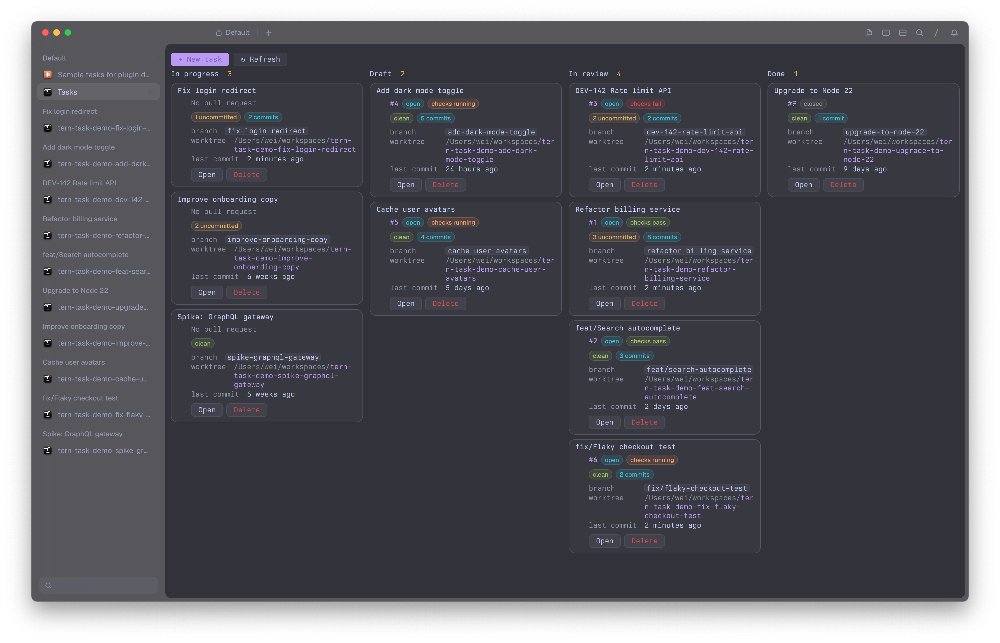

# Tasks for Tern

A [Tern](https://stencil.so/tern) plugin where **a task is a tab with its own git worktree**.

Start a task and you get a fresh branch, a worktree for it in one central folder, and a
tab in the current session running your default agent inside that worktree. Delete the task and
the tab, worktree and branch go away together, but git refuses to delete anything that holds work you
haven't committed or merged.

```
task name:  Fix login redirect
branch:     fix-login-redirect
worktree:   ~/tern/worktrees/my-repo/fix-login-redirect
tab:        Fix login redirect  (running the default agent)
```



## Install

```sh
tern plugin install github.com/yesmeck/tern-task-plugin
```

To work on the plugin itself, clone it and link the folder instead, so edits reload as you save:

```sh
git clone git@github.com:yesmeck/tern-task-plugin.git
tern plugin link tern-task-plugin
```

Requires `git`. The dashboard's pull request status also needs the
[GitHub CLI](https://cli.github.com) (`gh`), logged in.

## Commands

All four are in the command palette under **Tasks**.

| Command | Key | What it does |
|---|---|---|
| **New task** | ⌘⇧N | Asks for a task name, then creates the branch, the worktree and the tab |
| **Delete task** | | Closes a task's tab and removes its worktree and branch |
| **Task dashboard** | | Opens a kanban board of the current repository's tasks |
| **Task settings** | | Opens the settings screen for the focused pane's repository |

### New task

Run it from a pane inside a git repository. It:

1. Asks for a task name. The branch name is derived from it: lowercased, with runs of other
   characters turned into `-`. Slashes are kept, so `feat/Login page` becomes `feat/login-page`.
2. Creates the branch from the repository's [base branch](#task-settings) setting, or from the
   repository's default branch when no base branch is set. It then adds a worktree for the branch at
   `<worktree folder>/<repository>/<branch>`, with `/` in the branch replaced by `-`. The
   [worktree folder](#task-settings) defaults to `~/tern/worktrees`, and `<repository>` is the
   main checkout's folder name, even when you start the task from inside another worktree.
3. Opens a tab in the current session named after the task, running your default agent in the
   worktree.

On first load the plugin binds ⌘⇧N to New task through Tern's settings. It does this only once,
so if you rebind the key later, your choice stays.

### Delete task

Deletes the current tab's task, or one you pick from a list when the current tab isn't a task.
It:

1. Refuses if the worktree has uncommitted or untracked changes.
2. Closes the tab, with Tern's usual confirmation if something is still running.
3. Removes the worktree (`git worktree remove`) and deletes the branch (`git branch -d`).
   If the branch has unmerged commits, the branch is kept and a toast says so.

Closing a task's tab with Tern's own **Close tab**, or closing the session holding it with
**Close session**, cleans up the same way, except that it doesn't check for changes before
closing. If git then refuses to remove the worktree, the worktree stays on disk and a toast shows
git's message. A task tab that closes any other way (its last pane exited because the agent quit,
for example) keeps its worktree and branch.

The plugin only ever removes worktrees it created. Other tabs close normally, and other
worktrees are never touched.

### Task dashboard

A kanban board of the open tasks in the current window's repository, with one column per pull
request stage. The repository is the one holding the focused pane's directory, or, when the focused
pane has none (the dashboard itself, for example), that of another pane in the same tab, then in the
session. Each window's board shows its own repository, and running **Task dashboard** again after
moving to another repository switches the board to it. Outside any repository it shows every task.

| In progress | Draft | In review | Done |
|---|---|---|---|
| no PR yet | draft PR | open PR | merged or closed |

Each card shows:

- the pull request: number (a link), state, CI checks (pass, fail or running) and review decision
- the worktree's state: uncommitted files, commits not on the task's base branch (or the main
  checkout's branch for a task started without one), and the age of the last commit
- the branch and the worktree path
- **Open** (switch to the task's tab) and **Delete** buttons

**+ New task** on the board starts a task in the repository of another pane in the session, or,
if no pane has a directory, in the repository of the last task you started. The branch comes from the base branch setting, or from the repository's default branch if none is
set. **↻ Refresh** updates every card immediately, and **⚙ Settings** opens Task settings.

Git state refreshes every 15 seconds and pull requests once a minute.
`gh` looks up each task's branch on its own, all in parallel; asking for every PR in one call
times out on large repositories.

The board is a tab in the session you open it from.

### Status in tab names

Each task's tab name shows its status after the task name, so the tab bar doubles as an overview:

```
Fix login redirect · #3413 ✓ · ±2
Add CSV export · #3518 draft ●
Old idea · #3301 merged
hello task
```

- **PR:** the number, `draft` for a draft, then CI checks: `✓` passing, `✗` failing, `●` running.
  `merged` or `closed` replaces the checks once the PR is done.
- **`±N`:** uncommitted files in the worktree.
- **`worktree missing`:** the worktree folder is gone.

Names update in the background, git every 15 seconds and PRs once a minute, whether or not the
dashboard is open. A tab is renamed only when its status changes.

The part of the name before the first ` · ` is the task's name. Renaming a task's tab by hand
renames the task, and the status is added back after the new name. To turn the status off, set
`STATUS_IN_TAB_NAMES = false` in `window.luau`.

### Task settings

A settings screen with one setting that applies to all repositories, then the focused pane's
repository's own settings. When the focused pane has no directory (the dashboard, for example), the
repository is that of another pane in the session.

- **Worktree folder** (all repositories): where new tasks' worktrees go, as
  `<folder>/<repository>/<branch>`. The default is `~/tern/worktrees`. **Change…** opens a field
  for an absolute path or one starting with `~`; missing folders are created when a task starts.
  Moving the folder doesn't move existing tasks, which stay where they were created.
- **Base branch for new tasks** (per repository): the branch a new task starts from, for example `origin/cycle-86`.
  **Change…** lists the repository's remote and local branches, most recently committed first,
  after two choices: **The repository's default branch** and **The focused pane's current branch**.
  **Use the default branch** clears the setting.
  - **Default branch** (when nothing is set): origin's default branch (`origin/HEAD`, else
    `origin/main` or `origin/master`), else a local `main` or `master`, else the focused pane's
    `HEAD`.
  - **Remote branches** (`origin/…`) are fetched before the task's branch is created, so the task
    starts from the latest commit. If the fetch fails, the task starts from your local copy and
    git says so.
  - **No upstream:** the new branch never tracks its base, so `git push -u origin HEAD` pushes it
    under its own name.

The screen is a canvas, and Tern doesn't allow typing in a canvas, so each setting has a
**Change…** button that opens Tern's picker or a text prompt.

## Configuration

Beyond the [settings screen](#task-settings), these constants at the top of `window.luau` can be
changed:

| Constant | Default | |
|---|---|---|
| `OPEN_AGENT` | `true` | Start the default agent in a new task's tab, with no shell pane |
| `STATUS_IN_TAB_NAMES` | `true` | Show each task's status after its tab name |
| `DASHBOARD_REFRESH_MS` | `15000` | How often task git state refreshes |
| `PR_REFRESH_EVERY` | `4` | Fetch pull requests every Nth refresh |

The agent is whatever Tern's agent settings name (`omp` by default). If Tern can't start it in
place of the shell, the plugin falls back to **New agent block**, which opens it where Tern's
agent-placement setting says and leaves the shell open.

## How it works

- **Task records:** each task is saved in the plugin's key/value store (`tern.kv`), keyed by its
  tab's id. That record is how the plugin knows which tabs and worktrees are its own. Tasks from
  versions before 0.10, when each task was a session, move to their session's first tab on load.
  Settings are saved in the same store, keyed by the main checkout's path.
- **The 50 ms limit:** Tern gives each plugin handler 50 ms on the UI thread, and a handler that
  runs over is disabled until the plugins reload. So handlers here only read window state and
  start processes. Git, `gh` and the name prompt all run in callbacks. Each dashboard refresh is
  a single process however many tasks are open, and the board is redrawn only when what it shows
  has changed.

## Limitations

- **Older tabs:** tabs opened before you installed the plugin aren't tasks and are never cleaned
  up.
- **Other ways of closing:** a tab closed from `tern ctl`, Carly, or anything other than the
  **Close tab** and **Close session** commands keeps its worktree, as the plugin can't tell it
  from the agent quitting. Remove it with `git worktree remove <path>`.
- **Missed hooks:** if the plugin is reloaded while Tern is asking to confirm a close, the
  cleanup is lost. Remove the worktree by hand.
- **Short PATH:** a Tern opened from the Dock may have a short `PATH`, so the dashboard adds
  `/opt/homebrew/bin` and `/usr/local/bin` when looking for `gh`.

## Troubleshooting

If a command suddenly stops doing anything, a handler has probably run past its time limit and
been disabled. Run **Reload plugins** from the palette, then check the log:

```sh
grep -E 'worktree-sessions|budget' ~/Library/Logs/tern/tern.log | tail
```
